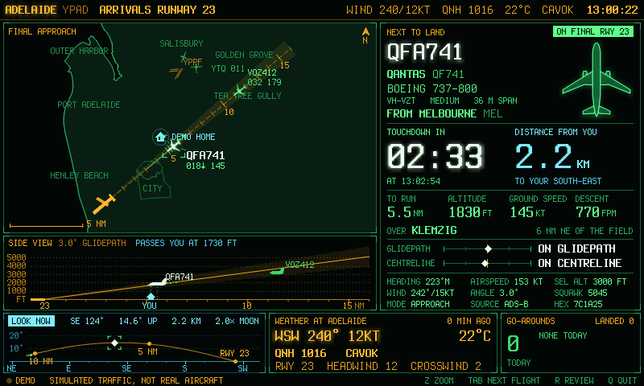
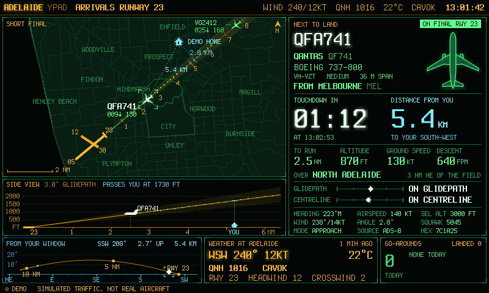
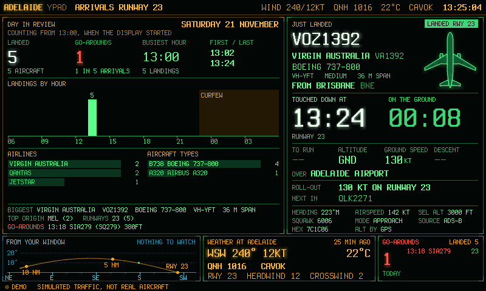
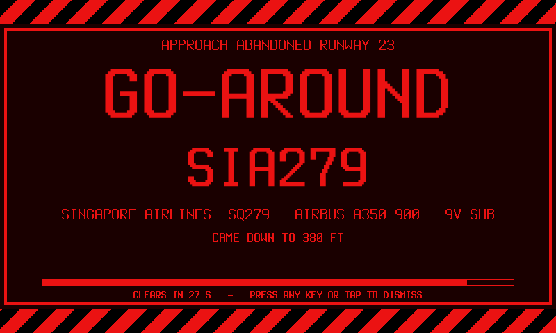

# Approach Scope

A live display of the aircraft arriving at your local airport, for a Raspberry Pi and a
small screen. Rather than a general radar of everything in the sky, it concentrates on the
approach you can see from home: **what is coming in, when it lands, and where to look.**

Works at any airport in the world with scheduled flights. It was built at Adelaide, which
gets extra detail (suburb names and boundaries); everywhere else gets the coastline,
lakes, towns and nearby airfields from public map data.



## What you get

Three colours carry the meaning everywhere: **green** is a live aircraft and its numbers,
**amber** is the chart (runway, glidepath, where aircraft should be), **cyan** is you.

- **Map** of the runway and the final approach, with a tick every mile, the coast and the
  towns around it. It zooms itself: the wider area while an arrival is still finding the
  approach, the full final once it is lined up, then your neighbourhood for the last miles.
- **Side view**: height against distance to run, with the 3 degree glidepath, so you can see
  how well each aircraft is flying the approach.
- **Flight card**: airline, flight number, aircraft type, registration and where it has
  come from; a **touchdown countdown**; distance to run, altitude, speed and descent rate;
  how far it is from you; how far above or below the glidepath and left or right of the
  centreline it is; and the fine print the aircraft transmits (heading, airspeed, selected
  altitude, wind at its level, crab angle, squawk).
- **From your window**: which way to look and how high, with **LOOK NOW** when it is close.
- **Weather**: wind, temperature, pressure, cloud, and the head and crosswind on the runway.
- **Go-arounds**: the whole screen flashes red with the flight number for 30 seconds, and a
  counter keeps the day's tally with every flight number so you can look them up.
- **Day in review** when nothing is arriving: landings, go-arounds, busiest hour, landings
  by hour, the top airlines and types, and the biggest aircraft of the day.
- **Day and night**: the picture dims after sunset and brightens at sunrise.



<p>
  
  
</p>

## Install

You need a Raspberry Pi (a Zero 2 W is enough) with Raspberry Pi OS and its desktop, a
screen (it is laid out for 800 x 480 and scales to larger ones), and an internet connection.

```
sudo apt install python3-pygame python3-requests
```
Put the `approach-scope` folder in your home folder (download the latest release zip and
unzip it, or `git clone` this repository), then:

```
cd ~/approach-scope
bash run.sh --setup        # where you watch from, your airport, the approach you can see
bash run.sh                # start it
bash run.sh --autostart on # start it automatically whenever the Pi's desktop starts
```

Setup asks for your location as coordinates (in Google Maps, right-click your place and
click the numbers to copy them) or a town name, then lists the nearby airports and the
approaches that pass you, and suggests the best one.

Other ways to run it:

```
bash run.sh --demo         # simulated traffic: try it before setting up, no internet needed
bash run.sh --check        # test the set-up (fonts, data, internet feeds, clock)
bash run.sh --window       # in a window instead of full screen
bash run.sh --autostart off
```

It should also run on Windows or a Mac with Python 3.9+ and `pip install pygame requests`
(`python main.py --setup`, then `python main.py --window`), though it is only tested on Linux.

Keys: **Q** / **Esc** quit, **Z** map zoom (auto, terminal, approach, short final),
**Tab** next flight, **R** day in review, **S** save a screenshot, **A** ATC audio (if set up).

## Your privacy

- Setup **rounds your location to about 100 m** before saving it. That is still accurate
  for every number on screen, and it means no file the program writes holds your address.
- Your location is only stored in `config.ini` on your own machine. It is not part of the
  download, and updates never overwrite it (shared defaults live in `config.default.ini`).
- Screenshots you take with **S**, and photos of the screen, do show your place on the map.
  Bear that in mind before posting them.
- The program asks the internet for: aircraft near the airport (adsb.fi), the airport
  weather (aviationweather.gov), and where each arriving flight has come from (adsbdb.com).
  None of these requests contain your location; they use the airport's.

## Updating

Download the new version and unzip it over the old folder. Your `config.ini`, the files
setup made in `local/`, and your landing history are kept.

## Settings

Your settings are in `config.ini`. Anything not in it comes from `config.default.ini`,
which documents every option; copy a line (with its `[Section]` heading) across to change it.

| Setting | What it does |
| --- | --- |
| `[Home] EYE_HEIGHT_M` | your eye height above sea level; add about 3 m per floor |
| `[Feed] URL` | adsb.fi by default; a local tar1090 `aircraft.json` works too |
| `[Display] MODE` | `auto` (dim after sunset), `day` or `night` |
| `[Display] STATS_WHEN_QUIET` | show the day in review whenever nothing is arriving |
| `[Display] GO_AROUND_ALERT` | the full-screen go-around alert, and `ALERT_SECONDS` for how long |
| `[Audio] ATC_STREAM_URL` | a live ATC audio stream for the A key (needs VLC) |

## How good are the numbers

- Positions, altitude, speed and descent rate are what the aircraft broadcasts (ADS-B),
  updated every 5 seconds and smoothed in between. Coverage depends on the volunteer
  receivers near your airport.
- Once an aircraft is lined up, the touchdown countdown is typically within about 20 seconds
  from 10 miles out and a few seconds inside 3 miles. Before then the time is shown as
  "about N min", because the route it will be given is not knowable.
- Receivers often lose aircraft in the last few hundred feet. When that happens the landing
  is assumed at the predicted time and marked as estimated.
- Outside Adelaide, runway positions come from OurAirports and are usually within a few
  tens of metres; the coastline is drawn from 1:10 million scale data, so it is approximate
  close up.

For interest only. Not for navigation or any operational use.

## Credits and data

- Live aircraft: [adsb.fi](https://adsb.fi) open data. Routes: [adsbdb.com](https://www.adsbdb.com).
  Weather: [aviationweather.gov](https://aviationweather.gov).
- Airports and runways: [OurAirports](https://ourairports.com/data/) (public domain).
- Coastline, lakes and towns: [Natural Earth](https://www.naturalearthdata.com) (public domain).
- Geoid: EGM96 (NGA). Magnetic variation: World Magnetic Model 2025 (NOAA / BGS).
- Adelaide suburbs and coast: incorporates or developed using Administrative Boundaries
  © Geoscape Australia, licensed by the Commonwealth of Australia under
  [CC BY 4.0](https://creativecommons.org/licenses/by/4.0/).
- Aircraft-type and airline tables: [tar1090-db](https://github.com/wiedehopf/tar1090-db)
  (Mictronics). Not included in the download; setup fetches them onto your machine.
- Font: Terminus TTF, SIL Open Font Licence (see `fonts/COPYING`).
- Inspired by [retro-adsb-radar](https://github.com/nicespoon/retro-adsb-radar).
- `tools/build_world.py` and `tools/build_geo.py` rebuild the bundled map data from the sources.

## Tests

```
python3 -m unittest discover -s tests
```

No network or screen needed. They cover a captured live adsb.fi response, an hour of
simulated traffic on every Adelaide runway and at Los Angeles (with a training circuit
right under the approach), go-arounds, lost-signal landings, setup at airports around the
world, and every panel drawn off-screen.

## Licence

MIT (see `LICENSE`).
